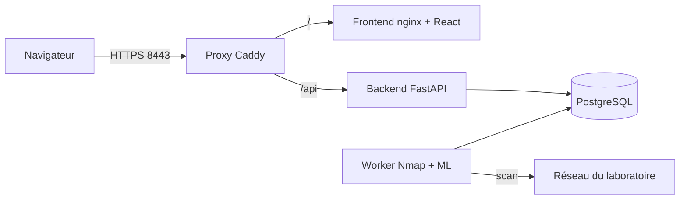
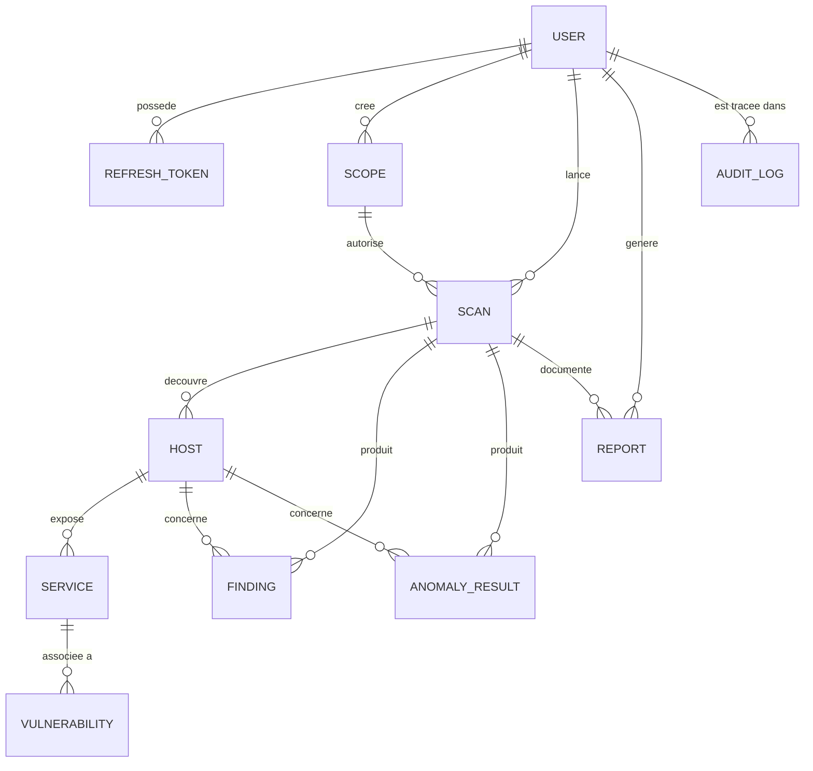

# Architecture

## Vue d'ensemble

| Service  | Rôle                                                             | Réseaux          |
| -------- | ---------------------------------------------------------------- | ---------------- |
| proxy    | Seul point d'entrée, HTTPS, routage `/` et `/api`                | public           |
| frontend | Interface React servie par nginx                                 | public           |
| backend  | API, authentification, règles, moteur de risques, rapports       | internal, public |
| worker   | Exécute Nmap, parse le XML, analyse les risques et les anomalies | internal, lab    |
| db       | PostgreSQL, jamais publié                                        | internal         |

## Déroulement d'un scan

1. L'utilisateur choisit une cible et un profil ; le backend valide la cible (périmètre, plages interdites, taille).
2. Le scan est enregistré avec le statut `pending` (la table `scans` sert de file de tâches).
3. Le worker le prend (`running`), revalide la cible, exécute Nmap sans shell, parse le XML avec `defusedxml`.
4. Résultats, constats et anomalies sont écrits dans **une seule transaction** ; statut `done` (ou `failed`, `cancelled`).

## Modèle de données

## Choix techniques et écarts assumés par rapport au cahier des charges

- **File de tâches** : la table `scans` (statuts `pending / running / done / failed / cancelled`) remplace une table
  `scan_jobs` séparée. Pas de Redis : suffisant pour un laboratoire de 10 à 20 machines.
- **Rapports PDF** stockés dans PostgreSQL (persistance simple, pas de volume à gérer).
- **Jetons** : JWT HS256 de 15 minutes ; jeton de renouvellement à usage unique, stocké haché, révocable.
- **Machine Learning** : Isolation Forest réentraîné de façon déterministe au démarrage du worker (aucun fichier
  pickle) sur des données synthétiques documentées (`docs/ml-evaluation.md`).
- **Docker** : le worker n'est pas privilégié (`cap_drop: ALL`, `NET_RAW` et `NET_ADMIN` seulement, lecture seule).
